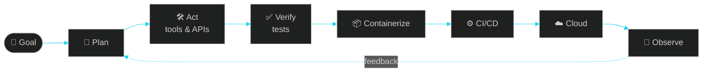

<div align="center">


<br/><br/>


_IT-f472b6?style=flat-square&labelColor=0d1117)

</div>

<br/>

## `~/whoami`

```yaml
name:        Mithun Appuhamy
role:        Agentic AI Developer · DevOps · Automation
education:   BSc (Hons) Information Technology — SLIIT, Malabe 🇱🇰
school:      Joseph Vaz College, Wennappuwa
mission:     Build AI agents that don't just answer — they act, ship and scale
stack_mode:  [agentic_ai: 90%, devops: always_on, ui_ux: obsessed]
availability: Local + International client projects · Remote-friendly
```

<br/>

## ⚡ Core Capabilities

<table>
<tr>
<td width="50%" valign="top">

### 🧠 Agentic AI Development
Autonomous agents, tool-using LLM apps and multi-step workflows that take real actions across real systems.

`AI Agents` `LLM Apps` `Tool Use` `MCP` `n8n`

</td>
<td width="50%" valign="top">

### 🚀 DevOps & Delivery
Everything I build ships through automated pipelines: containerized, versioned and repeatable.

`CI/CD` `Docker` `GitHub Actions` `Linux`

</td>
</tr>
<tr>
<td width="50%" valign="top">

### ☁️ Cloud Exposure
Deploying AI apps, serverless functions and data pipelines across the major clouds.

`AWS` `Azure` `Google Cloud`

</td>
<td width="50%" valign="top">

### 🎨 UI/UX + Full-Stack
AI products people enjoy using, designed in Figma and built end to end.

`MERN` `Next.js` `React Native` `.NET API` `Figma`

</td>
</tr>
</table>

<br/>

## 🔁 How My Agents Ship



<br/>

## 🧰 Arsenal

<div align="center">

**🤖 AI & Automation**<br/>


**💻 Build**<br/>


**🚀 DevOps & Cloud**<br/>


**📊 Data & BI**<br/>


</div>

<br/>

## 🌍 Client-Ready

```diff
+ Production-ready code      — clean, scalable, documented
+ Cloud-deployed             — Docker · CI/CD · AWS / Azure / GCP
+ AI-powered                 — agents, LLM apps, business automation
+ Reliable delivery          — tested, monitored, maintainable
+ Local 🇱🇰 & International 🌐 — remote-friendly, clear communication
```

<div align="center">

[](https://www.linkedin.com/in/mithun-appuhamy-998a8423a/)

</div>

<br/>

## 📡 Currently

```bash
$ status --now
🔭 building   → AI agents & agentic workflows
🛠️ automating → delivery with CI/CD pipelines
☁️ exploring  → deeper AWS · Azure · GCP
```

<br/>

<div align="center">

[](https://www.linkedin.com/in/mithun-appuhamy-998a8423a/)
[](https://www.instagram.com/mithunmh_19/)
[](https://web.facebook.com/profile.php?id=100074627900638)


</div>
